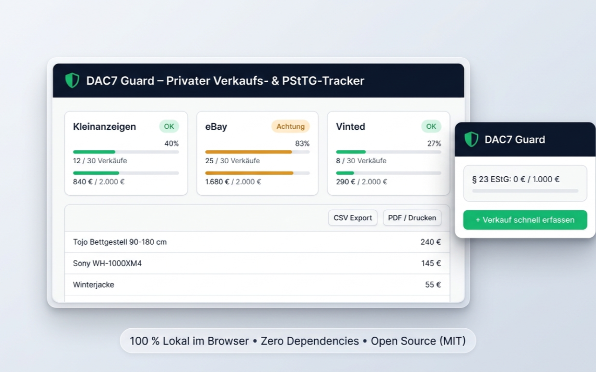

# 🛡️ DAC7 Guard

**100% local, zero-dependency open-source Chrome Extension (Manifest V3) to track your EU DAC7 marketplace reporting limits (`≥ 30 sales` or `> €2,000/year` per platform) and private resale records.**

> **100% Local (`chrome.storage.local`) • Zero Dependencies • Zero Servers • Zero Tracking • MIT License**



---

## Why DAC7 Guard?

Under **EU Directive 2021/514 (DAC7)** — implemented across **all 27 EU member states** (e.g., *PStTG* in Germany, *DPMG* in Austria, *DGFiP DAC7* in France) — online marketplaces (eBay, Vinted, Kleinanzeigen, Etsy, Wallapop, Leboncoin, Marktplaats, Willhaben, etc.) must automatically report private sellers to national tax authorities once you reach **either** threshold **per platform and calendar year**:

| EU DAC7 Threshold (per platform & year) | Trigger |
|---|---|
| **Number of sales** | **30 or more transactions** (`≥ 30`) |
| **Gross revenue** | **More than €2,000** (`> €2,000.00`) |

**Important:** Being reported does **not** automatically mean you owe taxes — selling your own used household items at a loss is generally tax-free across the EU. However, if tax authorities ask 1–2 years later, most people no longer have records of what they sold or originally paid. **DAC7 Guard** keeps a clean, private, exportable record locally in your browser.

*(Note for Germany: also tracks the **§ 23 EStG €1,000** short-term private resale profit exemption with intra-year loss offsetting.)*

---

## Features

- **Per-Platform DAC7 Traffic Light:** Progress bars for **30 sales** and **€2,000 revenue** per calendar year + toolbar badge warning at 80% (configurable).
- **Reportable vs. Private Cash Sales:** Separates platform-processed payments (e.g., Kleinanzeigen *„Sicher bezahlen“*, eBay, Vinted) from non-reportable private sales (cash pickup, private PayPal, bank transfer).
- **In-Page Quick-Capture & Auto-Prefill:** Shadow-DOM status pill on supported marketplaces; auto-prefills title, price, and listing ID on Kleinanzeigen listing pages and prompts when deleting/marking an ad as sold.
- **Profit/Loss & Tax Helper:** Optional original purchase price per item calculates net gain/loss and tracks short-term gains (`< 1 year` non-everyday items).
- **Audit-Ready Exports:**
  - **Excel-compatible CSV** (UTF-8 BOM, semicolon-delimited, Excel formula-injection hardened)
  - **Printable PDF Summary** (`window.print()` report layout)
  - **JSON Backup & Restore** (with deduplication)
- **Privacy by Design:** Only requires the `storage` permission. Zero external API calls, zero telemetry, zero runtime dependencies.

---

## Installation (Chrome, Brave, Edge, Arc)

No build step required — load directly from source in 30 seconds:

1. Clone this repository (or download as ZIP):
   ```bash
   git clone https://github.com/altantosun/dac7-guard.git
   ```
2. Open `chrome://extensions` in your browser.
3. Enable **Developer mode** (top right).
4. Click **Load unpacked** and select the `dac7-guard` folder.
5. Pin the 🛡️ **DAC7 Guard** icon to your toolbar.

---

## EU Marketplace Roadmap & Contribution TODOs

DAC7 applies across the entire EU — PRs for additional country adapters and translations are very welcome! See [CONTRIBUTING.md](./CONTRIBUTING.md) for how to add an adapter in ~50 lines of JS.

### Marketplace Adapters

| Region | Marketplace | Status | Notes / Adapter |
|---|---|---|---|
| 🇩🇪 Germany | **Kleinanzeigen** (`kleinanzeigen.de`) | ✅ Supported | Auto-prefill, delete prompt, order scanner, *Sicher bezahlen* vs. cash |
| 🇪🇺 Pan-EU | **eBay** (`.de`, `.at`, `.fr`, `.it`, `.es`, `.nl`, `.be`, `.ie`, `.pl`) | ✅ Supported | Multi-TLD seller hub orders adapter |
| 🇪🇺 Pan-EU | **Vinted** (`.de`, `.fr`, `.it`, `.es`, `.nl`, `.pl`, `.be`, `.at`, `.pt`) | ✅ Supported | Multi-TLD orders & member adapter |
| 🇦🇹 Austria | **Willhaben** (`willhaben.at`) | ✅ Supported | Auto-prefill, *PayLivery* (reportable) vs. cash pickup |
| 🇫🇷 France | **Leboncoin** (`leboncoin.fr`) | ✅ Supported | Auto-prefill, *Paiement sécurisé* vs. in-person cash |
| 🇳🇱 NL / 🇧🇪 BE | **Marktplaats / 2dehands / 2ememain** | ✅ Supported | Auto-prefill, *Betaalverzoek* vs. cash |
| 🇪🇸 ES / 🇮🇹 IT / 🇵🇹 PT | **Wallapop** (`wallapop.com`) | ✅ Supported | Auto-prefill, Wallapop Shipping vs. local meetup |
| 🇮🇹 Italy | **Subito.it** (`subito.it`) | ✅ Supported | Auto-prefill, *TuttoSubito* vs. local pickup |
| 🇪🇺 Pan-EU | **Etsy** (`etsy.com`) | ✅ Supported | Seller orders adapter |
| 🇵🇱 Poland | **OLX / Allegro Lokalnie** (`olx.pl`, `allegrolokalnie.pl`) | ⬜ TODO | Platform payment vs. cash |
| 🇸🇪 Sweden | **Blocket / Tradera** (`blocket.se`, `tradera.com`) | ⬜ TODO | SEK → EUR conversion helper needed |
| 🇪🇺 Pan-EU | **Vestiaire Collective / Depop** | ⬜ TODO | Fashion resale adapters |

### Core & UX TODOs

- [x] **i18n (`DE` + `EN`):** Automatic browser language detection + manual switcher in Dashboard settings *(community PRs for FR, ES, IT, NL, PL welcome!)*
- [x] **Firefox Add-on packaging:** `npm run pack:firefox` builds MV3 Firefox ZIP with `browser_specific_settings.gecko`
- [ ] **Chrome Web Store & Firefox AMO submission:** Ready to publish (`dist/dac7-guard-v0.2.0.zip` + Privacy Policy) — will be submitted as soon as we gather enough community feedback and real-world selector validation across marketplaces. *(Leave feedback or upvote via [GitHub Issues](https://github.com/altantosun/dac7-guard/issues)!)*
- [ ] **Multi-currency support:** Automatic EUR reference conversion for non-Euro EU states (PLN, SEK, CZK, DKK, HUF, RON)
- [ ] **Receipt/Photo attachment:** Store compressed local receipt thumbnails in IndexedDB for tax proof

---

## Development & Testing

Requires Node.js >= 20 (zero `npm install` packages required):

```bash
# Run all unit & integration tests (DAC7 rules, price parser, § 23 EStG, CSV/JSON, storage CRUD)
npm test

# Regenerate extension PNG icons
npm run icons

# Build a clean Chrome Web Store / GitHub Release zip in dist/
npm run pack
```

### Project Structure

```text
dac7-guard/
├── manifest.json                 # Chrome Extension Manifest V3
├── icons/                        # PNG icons (16, 48, 128 px)
├── assets/                       # Store showcase & promo images
├── scripts/
│   ├── generate-icons.js         # Zero-dependency PNG generator
│   └── pack.js                   # Release ZIP bundler
├── src/
│   ├── shared/
│   │   ├── rules.js              # EU DAC7 / PStTG & § 23 EStG logic
│   │   ├── storage.js            # chrome.storage.local CRUD & sanitization
│   │   └── export.js             # Excel-CSV & JSON backup/restore
│   ├── background/
│   │   └── service-worker.js     # Badge updates & serialized write queue
│   ├── content/
│   │   ├── overlay-widget.js     # Shadow-DOM pill & quick-capture modal
│   │   ├── kleinanzeigen.js      # kleinanzeigen.de adapter
│   │   ├── ebay.js               # ebay.de adapter
│   │   └── vinted.js             # vinted.de adapter
│   ├── popup/                    # Toolbar popup UI
│   └── dashboard/                # Full dashboard, print/PDF report & guide
└── tests/                        # Node.js native test suite
```

---

## Disclaimer

DAC7 Guard is a private open-source helper tool for personal record-keeping and **does not constitute legal or tax advice**. Tax rules vary by EU member state. Always consult a qualified tax advisor or your local tax authority if unsure.

## License

[MIT License](./LICENSE)
